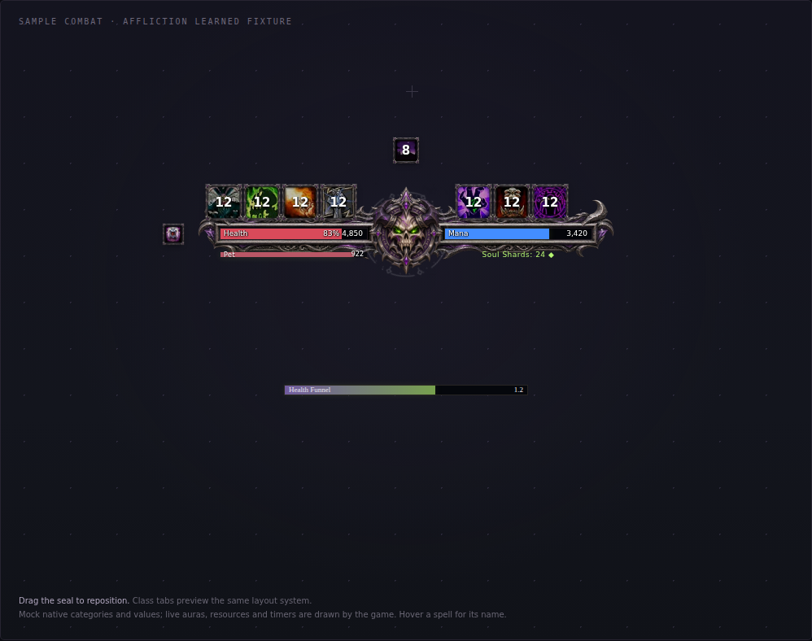

# Eclipse · Class Combat HUD

## English

**Version 0.3.5 — auras bundled in the addon (prerelease).** One companion supports all nine classes, with independent preferences and automatic class loading. The addon now carries the auras for every class: install it, and ForeverAuras offers your class's group in `/fa`. No string to paste. Manual class files remain available: [Warlock only](dist/classes/Eclipse-Warlock.txt) is roughly 83% smaller than the combined import; [exact sizes](dist/classes/README.md) are generated with each build.

### Install or update

1. Install **[ForeverAuras](https://github.com/neroxrw/foreverauras)**. The current source checked here is 1.3.7; the Forever interface is `16001`. EclipseHUD declares it as a dependency and does not load without it.
2. Download the [release ZIP](https://github.com/tomqwu/wow_forever_weakaura/releases) and copy **`EclipseHUD/`** into your current client's `Interface/AddOns/`. The TOC belongs directly inside that folder.
3. Enable EclipseHUD and ForeverAuras, then **`/reload`**.
4. Out of combat, open **`/fa`**. Your class appears under **ready to be installed** (first install, or a group installed before 0.3.5) or under **updates** (an older tagged group). Click it: ForeverAuras opens its own import window, and you confirm **Import** or **Update** there. **`/eclipse install`** opens the same window directly.
5. Choose **Update** for an existing class group; it preserves the combined parent and other classes. Avoid **Import as Copy** for updates.
6. Use **`/eclipse`** or **`/ehud`** for controls. Existing positions/preferences survive; **Position → Reset position** changes only X/Y.

The bundled import always matches the installed companion. Only the class you are playing is offered; log in on another class to install or update it. ForeverAuras recognises updates through a `wago.io/eclipse-hud-<class>/<build>` tag on each display. It reads only the build number and never connects to wago.io, so ignore that link if `/fa` shows it.

**Manual import** still works: paste a class file from **`imports/`** in the ZIP into **`/fa` → Import**. The optional **`Eclipse-Class-Combat-HUD.txt`** installs or updates a combined nine-class group. Class imports need the v0.3.5 companion or a compatible import API. Existing v0.3.2–v0.3.4 class strings remain compatible, so you can update one class at a time. The new compact wings and optional tracked-bar renderer need that class’s updated file. The ZIP includes nine class files, the combined file, and a size/SHA-256 manifest.

### Aura structure

Each class is one group whose direct children are organising sections, with nothing loose beside them except the cast bar:

| Section | Contents |
| --- | --- |
| Frame | Chassis, living runes, combat effects, seal, caption (drawn first, behind everything) |
| Resources | Health, class resource, pet health, shards/combo points/swing timers/totems |
| Primary | Main ability wings (native left/right) and Warrior usable-proc cues |
| Utility | Small on-cooldown Defense/Offense/Control rows |
| Native rows | Overflow cooldowns, utility and equipped items from the Cooldown Manager |
| Auras | Target effects, player effects, maintenance, tracked bars, reminders, weapon coatings |
| Nameplates | Optional nameplate debuff icons |
| Alerts | Invisible ready-alert triggers |
| Cast | Optional Eclipse cast bar |

Sections sit at `(0,0)`, so every display keeps its position. Display names and IDs are unchanged; an **Update** moves existing displays into their sections and removes the empty v0.3.2 slot groups.

**If an import or update stops part way** (loose `Eclipse | <Class> | …` entries at the top of the `/fa` list, bars at screen centre that ignore dragging): ForeverAuras stopped its import before it restored those parents, so updating again cannot reattach them. EclipseHUD detects this at login and prints a warning, and `/eclipse install` refuses to import over it (`/eclipse install force` overrides). Delete every top-level `Eclipse | <Class>` entry for that class, run `/eclipse install` (or import the class file again), and wait for the import window to finish before any `/reload`. Your `/eclipse` settings live separately and are kept. If it stops again, turn on Lua errors with `/console scriptErrors 1` and report the error text.

| Class | Smaller import |
| --- | --- |
| Warlock | [Warlock import](dist/classes/Eclipse-Warlock.txt) |
| Warrior | [Warrior import](dist/classes/Eclipse-Warrior.txt) |
| Mage | [Mage import](dist/classes/Eclipse-Mage.txt) |
| Priest | [Priest import](dist/classes/Eclipse-Priest.txt) |
| Rogue | [Rogue import](dist/classes/Eclipse-Rogue.txt) |
| Druid | [Druid import](dist/classes/Eclipse-Druid.txt) |
| Hunter | [Hunter import](dist/classes/Eclipse-Hunter.txt) |
| Shaman | [Shaman import](dist/classes/Eclipse-Shaman.txt) |
| Paladin | [Paladin import](dist/classes/Eclipse-Paladin.txt) |

### Configure cooldowns and preserve tracked bars

Open **`/eclipse` → Behavior → Cooldown layout → Forever**. Eclipse follows your learned native Essential/Utility/item categories and order, but shows cooldown icons **only while a real cooldown is running**, with GCD-only feedback excluded. The cooldown row is empty when no real cooldown is active. Ready, no-cooldown fillers such as Life Tap/Corruption do not occupy persistent cooldown slots. Instant-cast spells can still have genuine cooldowns. Native dynamic wings compact the shown icons. **Class plan** is an optional ability-row layout with its own priorities.

In the game's **Cooldown Settings**, arrange Essential, Utility, Items and Not Displayed as desired. Eclipse follows learned entries, not every gray entry shown by the configuration window. Changes made during combat apply after combat.

**CDM guide correction:** the v0.3.3 ZIP README's recommendation to set native Essential/Utility to Hidden is superseded by this guide. Keep them Always so their native event updates continue. The release assets remain unchanged.

**To keep the game's right-hand Tracked Bars:**

1. In **`/fa`**, leave the top-toolbar **Hide Blizzard's CDM** checkbox **off**. It hides all four viewers, including Tracked Bars.
2. Keep the game's cooldown manager enabled. In **Game menu → Edit Mode**, keep **Essential, Utility, Tracked Buffs and Tracked Bars → Visibility → Always**. Native **Hidden** unregisters viewer update events and can break mirrored tracking.
3. If you prefer the native cooldown icons too, disable duplicate **Eclipse Primary abilities / Utility abilities** modules. FA's global checkbox cannot hide only icon viewers while preserving the original native bars. Keeping native bars alongside Eclipse icons may leave duplicate native icons.
4. Leave **`/eclipse` → Modules → Tracked bars (Eclipse)** off if you want only the game's bars.

**To replace native bars with Eclipse bars:** enable **Tracked bars (Eclipse)** first. It uses native CDM aura progress for active entries from your Tracked Bars category, including DoTs/control/procs, in a stack to the right. Then you may use **Hide Blizzard's CDM** to hide the default viewers while keeping tracking enabled. Keep the native tracking viewers configured to Always for this route. Eclipse does not change these global settings automatically. To return to the default CDM later, clear the global hide and restore the relevant native viewer Visibility to Always.

Optional **`/fa cdmsetup`** / **Set Up CDM** asks to back up/copy the native layouts, track catalog entries, restore hidden spell cooldowns, set viewers to Always, hide all four default viewers and reload. It changes the layout/visibility choices above; use it deliberately rather than just to hide one row.

User-provided native configuration references (not Eclipse runtime validation):

| Cooldown categories | Tracked Bars |
| :---: | :---: |
| [](docs/images/native-warlock-cooldowns.png) | [](docs/images/native-warlock-tracked-bars.png) |

### DoT duration versus spell cooldown

Corruption/Immolate can be active on a target while their ability is ready. Their **remaining effect duration** belongs in **Target effects** or **Tracked Bars**, not a fabricated spell cooldown. Enable **Modules → Target effects**, target an enemy and apply the learned spell. This row shows native player-owned target effects; missing/unreadable effects are not assigned guessed timers. You can use native bars, Eclipse's optional tracked-bar stack, or the compact target-effect icons. Disable a duplicate display if you only want one presentation.

### Choose a casting bar

Open **`/eclipse` → Behavior → Cast bar display**. Click the control to cycle:

| Choice | Eclipse casting | Game casting |
| --- | --- | --- |
| Default game bar | Off; trackers unload | Available normally |
| Eclipse bar | On | Suppressed while the Eclipse display is loaded/enabled |
| Both bars | On | Available normally |

The safe default is the **game bar only**. Old overlapping defaults migrate to it; an existing explicit Eclipse-suppression choice is retained. **Modules → Eclipse cast bar** also enables/disables the Eclipse choice. Disabling Eclipse or an unavailable imported cast display releases its ownership of the game bar. Another addon can retain its own ownership. Changes requested in combat wait until combat ends.

Illustrative mode previews, using sample values rather than the game client:

| Game bar only | Eclipse bar only | Both (explicit) |
| :---: | :---: | :---: |
| [](preview/casting/warlock-default.png) | [](preview/casting/warlock-eclipse.png) | [](preview/casting/warlock-both.png) |

### Expand, fold and move

- **Left-click the seal:** expand for inspection; **click again to fold** out of combat, including with the same target selected. A new target/combat edge restores automatic behavior. Click inspection remains pinned until cancelled; `/eclipse inspect` and the settings inspection button are temporary.
- Combat events start motion immediately; the slide/fade takes about half a second. Enable **Behavior → Unfold animation** for smooth motion. Layout refreshes preserve an in-progress transition. Combat exit folds immediately if no independent target/inspection condition holds; target loss alone has a five-second hold.
- Folding affects the main HUD. Active effects, tracked bars and casting keep independent rules.
- **Right-click:** settings. Unlock there, then drag the seal. X/Y, scale, opacity and module choices are per class; root changes defer in combat. **Reset position** preserves other preferences.
- Health is crimson, mana blue, energy gold and rage orange; labels provide another cue. Maintenance buffs sit beside the bar. Nameplate effects are off by default. Disabled modules unload their trackers.

Illustrative interaction/animation previews:

| Folded | During opening | Click-expanded | Optional tracked bars |
| :---: | :---: | :---: | :---: |
| [](preview/states/warlock-idle.png) | [](preview/states/warlock-opening.png) | [](preview/states/warlock-click-open.png) | [](preview/states/warlock-tracked-bars.png) |

### Nine-class gallery and evidence

These are labelled browser fixtures with sample learned spells, active cooldowns/auras and values. They are not game-client screenshots or proof of full parity. The interactive [preview](https://github.com/tomqwu/wow_forever_weakaura/blob/main/preview/index.html) includes a leveling fixture with no invented real cooldowns, category/class-plan modes, bar choices, click toggling and resource-form colors.

| Warlock | Warrior | Mage |
| :---: | :---: | :---: |
| [](preview/classes/warlock.png) | [](preview/classes/warrior.png) | [](preview/classes/mage.png) |

| Priest | Rogue | Druid |
| :---: | :---: | :---: |
| [](preview/classes/priest.png) | [](preview/classes/rogue.png) | [](preview/classes/druid.png) |

| Hunter | Shaman | Paladin |
| :---: | :---: | :---: |
| [](preview/classes/hunter.png) | [](preview/classes/shaman.png) | [](preview/classes/paladin.png) |

Actual aura ownership, durations, stacks, cooldowns, charges, resource values and rendering belong to native ForeverAuras triggers. There is no combat-log reconstruction or guessed refresh window. Warlock armor is observed natively; an unknown armor aura never becomes a fabricated missing warning. [Live validation](docs/validation.md) remains pending; [the durable checklist](docs/feature-parity-plan.md) records source facts, implementations and evidence separately.

For problems, run **`/eclipse spells`** out of combat to print learned identities and native CDM categories/attachment diagnostics. This client's Lua errors are recorded in **`_forever_/Logs/General.log`**. The earlier mass-error popup also identified an independent AckisRecipeList health-prediction taint error; that addon is unchanged.

### Build and credits

Python 3.11+, Lua 5.1 and the build dependencies are required:

```bash
python -m pip install -r requirements-dev.txt
python scripts/build.py
python scripts/check.py
python scripts/preview.py
lua tests/native-schema.lua /path/to/ForeverAuras
```

Source: `src/catalog.py`, `scripts/build.py`, `src/EclipseHUD/`. Generated class files: `dist/classes/`; the combined export stays in `dist/`. CI verifies versions, codec/graphs/IDs, native schemas, package bytes and browser behavior. Every release updates the docs, relevant captures and changelog; published assets are immutable. See [design notes](docs/design.md) and [CHANGELOG](CHANGELOG.md).

Inspired by the supplied Guos Warrior HUD's feature organization. No Guos scripts, artwork, sounds or branding are bundled. Original AI-painted masters/prompts are in [assets/ai](https://github.com/tomqwu/wow_forever_weakaura/tree/main/assets/ai); builds reuse them. Game spell artwork remains Blizzard's property. GPL-2.0; see [LICENSE](LICENSE) and [vendor notices](https://github.com/tomqwu/wow_forever_weakaura/blob/main/vendor/README.md).

## 简体中文

**版本 0.3.5：光环随插件附带（预发布）。** 一套配套插件支持九职业，按当前角色自动加载，并分别保存设置。插件现已附带所有职业的光环：安装后，ForeverAuras 会在 `/fa` 中提供当前职业的光环组，无需粘贴字符串。手动职业文件仍可使用：[术士独立导入](dist/classes/Eclipse-Warlock.txt)比合并文件约小 83%；[精确大小](dist/classes/README.md)由构建自动生成。

### 安装与更新

1. 先安装 **[ForeverAuras](https://github.com/neroxrw/foreverauras)**。当前校验的安装源码版本为 1.3.7，无限服接口版本为 `16001`。EclipseHUD 将其声明为依赖，未安装时不会加载。
2. 下载[发布 ZIP](https://github.com/tomqwu/wow_forever_weakaura/releases)，把 **`EclipseHUD/`** 放入当前客户端的 `Interface/AddOns/`，TOC 文件应直接位于该文件夹中。
3. 启用 EclipseHUD 与 ForeverAuras，然后输入 **`/reload`**。
4. 脱离战斗后打开 **`/fa`**。当前职业会出现在 **待安装（ready to be installed）**（首次安装，或 0.3.5 之前安装的组）或 **更新** 列表中（带有旧版本标记的组）。点击后，ForeverAuras 会打开自己的导入窗口，由你确认 **导入** 或 **更新**。也可输入 **`/eclipse install`** 直接打开同一窗口。
5. 已有职业组请选择 **更新（Update）**，不要导入为副本。更新仅涉及该职业，保留其原有合并父组及其他职业。
6. 输入 **`/eclipse`** 或 **`/ehud`** 配置。升级保留位置和偏好；**位置与缩放 → 重置位置** 只重置 X/Y。

随附的导入始终与已安装的配套插件一致。只提供当前所玩的职业；如需安装或更新其他职业，请登录该职业的角色。ForeverAuras 通过每个显示上的 `wago.io/eclipse-hud-<职业>/<构建号>` 标记识别更新：它只读取构建号，不会连接 wago.io；若 `/fa` 中显示该链接，可忽略。

**手动导入**仍然可用：把 ZIP 内 **`imports/`** 中的职业文件粘贴到 **`/fa` → 导入**。可选的 **`Eclipse-Class-Combat-HUD.txt`** 用于安装或更新九职业合并组。职业文件需要 0.3.5 配套插件或兼容的导入接口；原有 0.3.2–0.3.4 职业字符串仍可使用，因此可以逐个职业更新。ZIP 同时包含九份独立文件、合并文件，以及大小和 SHA-256 清单。

### 光环结构

每个职业是一个组，其直接子项只有分区组；除施法条外，没有散放的显示：

| 分区 | 内容 |
| --- | --- |
| Frame（框架） | 底座、流动符文、战斗特效、徽记、标题（最先绘制，位于最底层） |
| Resources（资源） | 生命值、职业资源、宠物生命、灵魂碎片/连击点/挥击计时/图腾 |
| Primary（主技能） | 主技能左右两翼（原生）与战士可用触发提示 |
| Utility（辅助） | 仅冷却中显示的防御/进攻/控制小图标行 |
| Native rows（原生行） | 冷却管理器中的溢出冷却、辅助技能与装备物品 |
| Auras（光环） | 目标效果、自身效果、维持类光环、持续时间条、提醒、武器涂层 |
| Nameplates（姓名板） | 可选的姓名板减益图标 |
| Alerts（提示） | 不可见的就绪提示触发器 |
| Cast（施法条） | 可选的 Eclipse 施法条 |

分区位于 `(0,0)`，因此每个显示的位置不变；显示名称与 ID 不变。选择 **更新（Update）** 会把现有显示移入对应分区，并删除 0.3.2 遗留的空槽位组。

**如果导入或更新中途停止**（`/fa` 列表顶层出现散放的 `Eclipse | <职业> | …` 条目，条形停在屏幕中央且无法拖动）：说明 ForeverAuras 在恢复这些父组之前停止了导入，再次更新也无法重新挂回。EclipseHUD 会在登录时检测到这种情况并提示，`/eclipse install` 也会拒绝在此状态下导入（`/eclipse install force` 可强制）。请删除该职业所有顶层 `Eclipse | <职业>` 条目，输入 `/eclipse install`（或重新导入职业文件），并等导入窗口完成后再 `/reload`。`/eclipse` 设置单独保存，不受影响。如果再次停止，请用 `/console scriptErrors 1` 打开 Lua 错误提示，并报告错误内容。

| 职业 | 独立导入 |
| --- | --- |
| 术士 | [术士独立导入](dist/classes/Eclipse-Warlock.txt) |
| 战士 | [战士独立导入](dist/classes/Eclipse-Warrior.txt) |
| 法师 | [法师独立导入](dist/classes/Eclipse-Mage.txt) |
| 牧师 | [牧师独立导入](dist/classes/Eclipse-Priest.txt) |
| 盗贼 | [盗贼独立导入](dist/classes/Eclipse-Rogue.txt) |
| 德鲁伊 | [德鲁伊独立导入](dist/classes/Eclipse-Druid.txt) |
| 猎人 | [猎人独立导入](dist/classes/Eclipse-Hunter.txt) |
| 萨满祭司 | [萨满祭司独立导入](dist/classes/Eclipse-Shaman.txt) |
| 圣骑士 | [圣骑士独立导入](dist/classes/Eclipse-Paladin.txt) |

### 配置冷却管理器，并保留右侧持续时间条

打开 **`/eclipse` → 战斗行为 → 冷却排列 → 系统冷却管理器（Forever）**。Eclipse 沿用系统中已学技能的主要、辅助、装备分组与顺序，但默认**只在真实冷却运行时显示冷却图标，排除仅有公共冷却的情况**；没有真实冷却在运行时，该行为空。Life Tap、Corruption 等没有独立冷却的填充技能不会常驻占位；瞬发技能也可能有真实冷却，不能仅凭“瞬发”判断。原生动态组会紧凑排列当前显示的图标。可选的 **职业方案（Class plan）** 是另一种有固定优先级的技能展示布局。

在游戏的 **Cooldown Settings（冷却设置）** 中调整 Essential、Utility、Items 与 Not Displayed。配置窗口中的灰色条目不代表角色已学会；战斗中提出的修改在脱战后应用。

**CDM 指南更正：** v0.3.3 ZIP 内 README 中把系统 Essential/Utility 设为 Hidden 的建议已被本页取代。请保持 Always，保证原生更新事件继续工作。已发布的文件保持不变。

**保留游戏原有右侧 Tracked Bars：**

1. 在 **`/fa`** 顶部工具栏，**不要勾选 Hide Blizzard's CDM**。这个总开关会隐藏四类系统窗口，也包括持续时间条。
2. 保持游戏冷却管理器启用。在 **游戏菜单 → 编辑模式** 中，把 **Essential、Utility、Tracked Buffs、Tracked Bars → Visibility（可见性）** 保持为 **Always（始终）**。系统 **Hidden** 会注销窗口更新事件，可能使镜像追踪失效。
3. 如果也使用系统冷却图标，可关闭重复的 **Eclipse 主要技能 / 辅助技能** 模块。FA 总隐藏开关不能单独隐藏图标而保留系统持续时间条；同时保留系统条与 Eclipse 图标时，可能仍有重复的系统图标。
4. 使用系统持续时间条时，可让 **`/eclipse` → 显示模块 → 持续时间条（Eclipse）** 保持关闭。

**改用 Eclipse 持续时间条：** 先启用 **持续时间条（Eclipse）**。它通过 ForeverAuras 原生 CDM 光环进度，在右侧显示你配置的 Tracked Bars 中当前激活的 DoT、控制效果和触发效果。确认启用后，才使用 **Hide Blizzard's CDM** 隐藏系统窗口；原生追踪继续开启，此方案下系统追踪窗口保持 Always。Eclipse 不会自动修改这些全局设置。之后返回系统 CDM 时，取消全局隐藏，并把相应系统窗口的可见性恢复为 Always。

可选命令 **`/fa cdmsetup`** 或 **Set Up CDM** 会先询问确认，再备份/复制布局、追踪目录条目、恢复隐藏的技能冷却、设为 Always、隐藏四类系统窗口并重载。它会改变前面的布局与可见性选择，不要把它当成“只隐藏某一排”的开关。

用户提供的游戏内配置参考图，**不代表 Eclipse 当前版本已通过游戏实测**：

| 冷却分组 | 持续时间条 |
| :---: | :---: |
| [](docs/images/native-warlock-cooldowns.png) | [](docs/images/native-warlock-tracked-bars.png) |

### DoT 剩余时间与技能冷却是两回事

Corruption、Immolate 在目标身上持续生效时，技能本身可以已经可用。**效果剩余时间** 应在 **目标持续效果** 或 **持续时间条** 中显示，不应伪造成技能冷却。启用 **显示模块 → 目标持续效果**，选中敌对目标并施放已学技能；该行只显示原生观测到的自身施加效果，不会为缺失或不可读状态估算时间。你可以保留系统条、使用 Eclipse 条，或使用紧凑图标；只需要一种展示时，关闭重复的一项即可。

### 选择施法条

打开 **`/eclipse` → 战斗行为 → 施法条显示**，点击按钮循环选择：

| 选择 | Eclipse 施法条 | 系统施法条 |
| --- | --- | --- |
| 系统施法条 | 关闭并卸载追踪 | 正常保留 |
| Eclipse 施法条 | 启用 | 仅在 Eclipse 施法显示已加载且启用时抑制 |
| 同时显示 | 启用 | 正常保留 |

安全默认是**只保留系统施法条**。旧版默认同时显示的配置会迁移到此选项；之前明确启用 Eclipse 抑制系统条的设置会保留。**显示模块 → Eclipse 施法条** 也可启用或关闭 Eclipse 选项。禁用 Eclipse 或导入的施法显示不可用时，会释放对系统施法条的控制；其他插件可能仍有自己的控制。战斗中修改会等脱战后应用。

以下为使用样例数据的浏览器预览，不是游戏截图：

| 仅系统条 | 仅 Eclipse 条 | 明确同时显示 |
| :---: | :---: | :---: |
| [](preview/casting/warlock-default.png) | [](preview/casting/warlock-eclipse.png) | [](preview/casting/warlock-both.png) |

### 展开、收起与移动

- **左键点击徽记：** 脱战时展开检查；**再点一次收起**，即使仍选中同一敌对目标也能收起。更换目标或进入战斗后恢复自动规则。点击展开会保持，直到取消；`/eclipse inspect` 和设置中的预览按钮则是临时展开。
- 战斗事件立即开始动画，滑动和淡入淡出约半秒完成。启用 **战斗行为 → 展开与收拢动画** 保留平滑效果；布局刷新不会跳到动画终点。脱战且没有目标/检查条件时立即开始收起，单独丢失目标则保留五秒延迟。
- 收起主要 HUD 时，生效中的持续效果、追踪条和施法条仍遵循各自规则。
- **右键打开设置。** 解锁后拖动徽记；X/Y、缩放、透明度与模块按职业保存。战斗中延迟根布局修改；重置位置保留其他选项。
- 生命为深红，法力为蓝色，能量为金色，怒气为橙色，并保留文字标签。常驻增益位于侧边；姓名板效果默认关闭。关闭模块会卸载其追踪。

交互与动画的示意预览：

| 收起 | 展开过程 | 点击展开 | 可选持续时间条 |
| :---: | :---: | :---: | :---: |
| [](preview/states/warlock-idle.png) | [](preview/states/warlock-opening.png) | [](preview/states/warlock-click-open.png) | [](preview/states/warlock-tracked-bars.png) |

### 九职业预览与验证范围

以下均为明确标注的浏览器样例，使用模拟已学技能、当前冷却、光环与数值，不是游戏截图，也不是完整功能对齐的证明。[交互预览](https://github.com/tomqwu/wow_forever_weakaura/blob/main/preview/index.html)包含无伪造真实冷却的升级样例、分组/职业方案、施法条选择、重复点击开合与形态资源颜色。

| 术士 | 战士 | 法师 |
| :---: | :---: | :---: |
| [](preview/classes/warlock.png) | [](preview/classes/warrior.png) | [](preview/classes/mage.png) |

| 牧师 | 盗贼 | 德鲁伊 |
| :---: | :---: | :---: |
| [](preview/classes/priest.png) | [](preview/classes/rogue.png) | [](preview/classes/druid.png) |

| 猎人 | 萨满祭司 | 圣骑士 |
| :---: | :---: | :---: |
| [](preview/classes/hunter.png) | [](preview/classes/shaman.png) | [](preview/classes/paladin.png) |

光环归属、持续时间、层数、冷却、充能、资源与受限数值渲染均交给 ForeverAuras 原生触发器；不使用战斗记录重建或猜测刷新时间。术士护甲按原生状态显示，不把未知状态当作“缺失”。[游戏内验证](docs/validation.md)仍待完成；[持久清单](docs/feature-parity-plan.md)分别记录源码事实、实现与证据。

排查时可脱战运行 **`/eclipse spells`**，打印已学技能、原生 CDM 分组及挂接诊断。此客户端的 Lua 错误位于 **`_forever_/Logs/General.log`**。此前大量错误弹窗还涉及独立的 AckisRecipeList 生命预测污染错误，本项目未修改该插件。

### 构建与版权

需要 Python 3.11+、Lua 5.1 和构建依赖：

```bash
python -m pip install -r requirements-dev.txt
python scripts/build.py
python scripts/check.py
python scripts/preview.py
lua tests/native-schema.lua /path/to/ForeverAuras
```

源码位于 `src/catalog.py`、`scripts/build.py` 和 `src/EclipseHUD/`；职业文件位于 `dist/classes/`，合并导出仍在 `dist/`。CI 校验版本、编码内容、图结构/ID、原生规则、包字节与浏览器行为。每次发布同步文档、相关截图和更新日志，已发布文件不可覆盖。详见[设计说明](docs/design.md)与[更新日志](CHANGELOG.md)。

功能组织参考用户提供的 Guos 战士 HUD，但不包含其脚本、图片、声音或品牌素材。原创 AI 绘画源图和提示词保存在 [assets/ai](https://github.com/tomqwu/wow_forever_weakaura/tree/main/assets/ai)，构建复用现有源图。游戏技能图标归暴雪所有。采用 GPL-2.0，见 [LICENSE](LICENSE)和[第三方声明](https://github.com/tomqwu/wow_forever_weakaura/blob/main/vendor/README.md)。
